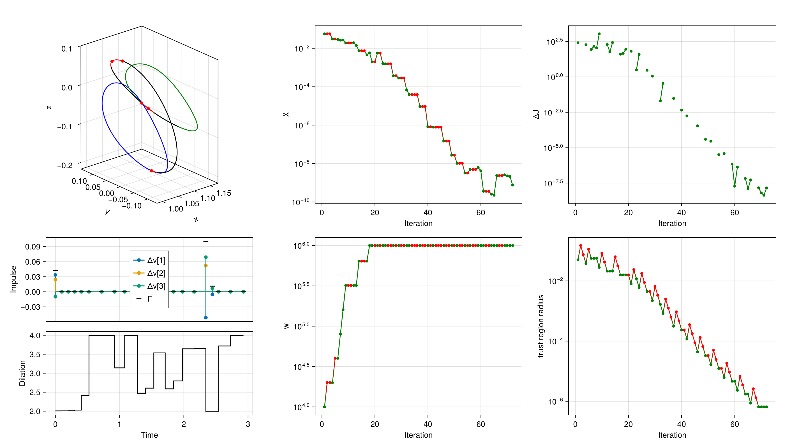

```@meta
EditURL = "../../literate/advanced/impulsive_control_variable_time.jl"
```

# Impulsive control with variable time

This page walks through
[`examples/cr3bp/ex_scvxstar_cr3bp_impulsive_freetf.jl`](https://github.com/eXplorationLogisticsControl/SCPLib.jl/blob/main/examples/cr3bp/ex_scvxstar_cr3bp_impulsive_freetf.jl):
a transfer between two libration point orbits (LPOs) in the circular restricted three-body
problem (CR3BP), flown with impulsive maneuvers only, with a free time of flight.

Impulses alone cannot make the time of flight a decision variable: the time spent on each
coast arc has to be a control that acts *during* the coast. The problem is therefore posed as a
[`MixedProblem`](@ref SCPLib.MixedProblem), which combines

- a **continuous** control, held constant on each segment, that enters the coast dynamics, and
- an **impulsive** control, applied as an instantaneous jump at each node.

Here, the only continuous control is a time-dilation factor, and the impulsive control is the
$\Delta \boldsymbol{v}$.

!!! note "Why not `ImpulsiveProblem`?"
    `ImpulsiveProblem` linearizes each segment as $\Phi_B = \Phi_A \, \partial \boldsymbol{x}^+ / \partial \boldsymbol{u}$,
    i.e. it assumes the control only enters through the jump at the start of the segment.
    A control that also enters the coast (such as a time dilation) would be missing from the
    linearization, so the convex subproblems would not see how the time of flight affects the dynamics.

!!! tip "Running this page"
    This page is generated with [Literate.jl](https://github.com/fredrikekre/Literate.jl) from
    `docs/literate/advanced/impulsive_control_variable_time.jl`, which is a runnable script:
    ```
    julia --project=examples docs/literate/advanced/impulsive_control_variable_time.jl
    ```
    Running it solves the problem and regenerates the figure shown at the end of this page.

## Problem formulation

### Time-dilated dynamics

The physical time $t$ is replaced by an independent variable $\tau \in [0, 1]$, discretized into
$N$ nodes $\tau_1, \ldots, \tau_N$. On segment $k$ ($\tau \in [\tau_k, \tau_{k+1}]$), the physical time
advances at the rate $s_k = \mathrm{d}t / \mathrm{d}\tau$, so that the state
$\boldsymbol{x} = [\boldsymbol{r}^T, \boldsymbol{v}^T, t]^T \in \mathbb{R}^7$ evolves according to

```math
\frac{\mathrm{d}\boldsymbol{x}}{\mathrm{d}\tau} = s_k \, \boldsymbol{g}(\boldsymbol{x}) ,
\quad
\boldsymbol{g}(\boldsymbol{x}) =
\begin{bmatrix}
    \boldsymbol{f}_{\mathrm{CR3BP}}(\boldsymbol{r}, \boldsymbol{v}) \\ 1
\end{bmatrix} ,
```

where $\boldsymbol{f}_{\mathrm{CR3BP}}$ is the natural (uncontrolled) CR3BP vector field. The
physical time is carried as the 7th state, so the time of flight is $t_N - t_1$.

### Controls

- The continuous control is $\boldsymbol{u}^{c}_k = s_k \in \mathbb{R}$ (`nuc = 1`), defined on the segments $k = 1, \ldots, N-1$.
- The impulsive control is $\boldsymbol{u}^{i}_k = [\Delta \boldsymbol{v}_k^T, \Gamma_k]^T \in \mathbb{R}^4$ (`nui = 4`), defined on all nodes $k = 1, \ldots, N$, including an arrival burn at node $N$. $\Gamma_k$ is a slack variable for the impulse magnitude.

Each segment first applies the jump, then coasts:

```math
\boldsymbol{x}_k^+ = \boldsymbol{x}_k + B \, \boldsymbol{u}^{i}_k ,
\quad
B = \begin{bmatrix} 0_{3\times 3} & 0_{3 \times 1} \\ I_3 & 0_{3 \times 1} \\ 0_{1\times 3} & 0 \end{bmatrix} ,
\quad
\boldsymbol{x}_{k+1} = \boldsymbol{x}_k^+ + \int_{\tau_k}^{\tau_{k+1}} s_k \, \boldsymbol{g}(\boldsymbol{x}) \, \mathrm{d}\tau .
```

### Optimal control problem

```math
\begin{aligned}
    \min_{\boldsymbol{x}, s, \Delta \boldsymbol{v}, \Gamma}
    \quad& \sum_{k=1}^{N} \Gamma_k
    \\ \text{s.t.}\quad&
    \boldsymbol{x}_{k+1} = \boldsymbol{\phi}\left( \boldsymbol{x}_k + B \boldsymbol{u}^{i}_k, s_k \right)
    \quad k=1,\ldots,N-1
    \\&
    \boldsymbol{r}_1 = \boldsymbol{r}_0 , \quad \boldsymbol{v}_1 = \boldsymbol{v}_0 , \quad t_1 = 0
    \\&
    \boldsymbol{r}_N = \boldsymbol{r}_f , \quad \boldsymbol{v}_N + \Delta \boldsymbol{v}_N = \boldsymbol{v}_f
    \\&
    \| \Delta \boldsymbol{v}_k \|_2 \leq \Gamma_k \leq \Delta v_{\max} \quad k=1,\ldots,N
    \\&
    s_{\min} \leq s_k \leq s_{\max} \quad k=1,\ldots,N-1
    \\&
    t_{f,\min} \leq t_N \leq t_{f,\max}
\end{aligned}
```

where $\boldsymbol{\phi}$ is the flow of the time-dilated dynamics over one segment. Since
$\Gamma_k$ is minimized, $\Gamma_k = \| \Delta \boldsymbol{v}_k \|_2$ at the optimum, so the objective
is the total $\Delta v$. The dilation of each segment is free within its bounds, so the transfer can
spend more physical time on some arcs than on others.

### The control matrix of a `MixedProblem`

On nodes $k = 1, \ldots, N-1$, the control is stacked as
$\boldsymbol{u}_k = [\boldsymbol{u}^{c}_k; \boldsymbol{u}^{i}_k] \in \mathbb{R}^{5}$.
At node $N$, only the impulsive part exists. SCPLib keeps the control as a square
`(nuc + nui, N)` matrix, and the unused continuous entries `u[1:nuc, N]` hold `NaN`:

```math
U =
\begin{bmatrix}
    s_1 & s_2 & \cdots & s_{N-1} & \texttt{NaN} \\
    \Delta \boldsymbol{v}_1 & \Delta \boldsymbol{v}_2 & \cdots & \Delta \boldsymbol{v}_{N-1} & \Delta \boldsymbol{v}_N \\
    \Gamma_1 & \Gamma_2 & \cdots & \Gamma_{N-1} & \Gamma_N
\end{bmatrix}
```

The reference control `u_ref` passed to the constructor must follow this layout, and the
solution returned by the algorithms does as well. Propagation, linearization and trust-region
updates never read the `NaN` entries. In the JuMP model, `prob.model[:uc]` (size `(nuc, N-1)`)
and `prob.model[:ui]` (size `(nui, N)`) are the decision variables, and `prob.model[:u]` is the
stacked matrix above.

### Linearization

Linearizing segment $k$ about the reference gives
$\boldsymbol{x}_{k+1} \approx \Phi_{A,k} \boldsymbol{x}_k + \Phi_{B,k} \boldsymbol{u}_k + \boldsymbol{\Phi}_{c,k}$, with

```math
\Phi_{B,k} = \begin{bmatrix} \Phi_{B,k}^{c} & \Phi_{A,k} B \end{bmatrix} ,
```

where $\Phi_{A,k}$ is the state transition matrix of the coast (started after the jump), and
$\Phi^{c}_{B,k}$ is the sensitivity of the end of the coast to the continuous control. Both are
integrated along the coast with

```math
\frac{\mathrm{d}\Phi_A}{\mathrm{d}\tau} = s_k \frac{\partial \boldsymbol{g}}{\partial \boldsymbol{x}} \Phi_A ,
\quad
\frac{\mathrm{d}\Phi^{c}_B}{\mathrm{d}\tau} = s_k \frac{\partial \boldsymbol{g}}{\partial \boldsymbol{x}} \Phi^{c}_B + \boldsymbol{g}(\boldsymbol{x}) ,
\quad
\Phi_A(\tau_k) = I_7, \quad \Phi^{c}_B(\tau_k) = 0_{7 \times 1} .
```

The term $\boldsymbol{g}(\boldsymbol{x}) = \partial (s_k \boldsymbol{g}) / \partial s_k$ is what lets the
subproblem trade time of flight against $\Delta v$.

## Implementation

### Setup

We start with the imports. In the examples, SCPLib is loaded by including its source; with SCPLib
installed as a package, use
```julia
using SCPLib
```
instead.

```julia
using CairoMakie
using Clarabel
using JuMP
using LinearAlgebra
using OrdinaryDiffEq
```

We define the physical parameters and the canonical units of the Earth-Moon system.

```julia
struct ControlParams
    μ::Float64
end

μ = 1.215058560962404e-02
DU = 389703     # km
TU = 382981     # sec
MU = 500.0      # kg
VU = DU/TU      # km/s
params = ControlParams(μ)
```

### Dynamics

The vector field $\boldsymbol{g}(\boldsymbol{x})$ is the natural CR3BP vector field, with the
physical time rate $\mathrm{d}t/\mathrm{d}t = 1$ appended as the 7th component.

```julia
function cr3bp_field!(g, x, μ)
    xx, yy, zz = x[1], x[2], x[3]
    vx, vy, vz = x[4], x[5], x[6]
    r1 = sqrt((xx + μ)^2 + yy^2 + zz^2)
    r2 = sqrt((xx - 1 + μ)^2 + yy^2 + zz^2)
    g[1] = vx
    g[2] = vy
    g[3] = vz
    g[4] =  2*vy + xx - ((1 - μ)/r1^3)*(μ + xx) + (μ/r2^3)*(1 - μ - xx)
    g[5] = -2*vx + yy - ((1 - μ)/r1^3)*yy - (μ/r2^3)*yy
    g[6] = -((1 - μ)/r1^3)*zz - (μ/r2^3)*zz
    g[7] = 1.0
    return g
end
```

The coast dynamics `eom!` has the same signature as for the other problem types,
`eom!(dx, x, (; params, u), t)`, but for a `MixedProblem` the `u` it receives is **only the
continuous slice** $\boldsymbol{u}^{c}_k$ (here, $s_k$).

```julia
function eom!(dx, x, pu, t)
    (; params, u) = pu
    cr3bp_field!(dx, x, params.μ)
    dx[1:7] .*= u[1]
    return
end
```

The jump is defined by `dfdu(x, u_i, t)`, which returns the `(nx, nui)` matrix $B$:
the first three impulsive entries are added to the velocity, while $\Gamma$ and the time are unchanged.

```julia
function dfdu(x, u_i, t)
    return [zeros(3, 4); I(3) zeros(3, 1); zeros(1, 4)]
end
```

Optionally, we provide the augmented coast dynamics `eom_aug!`, which integrates the state
together with $\Phi_A$ and $\Phi^{c}_B$. The augmented state is
$[\boldsymbol{x}; \mathrm{vec}(\Phi_A); \mathrm{vec}(\Phi^{c}_B)]$, where $\Phi^{c}_B$ has `nuc` columns;
the impulsive block $\Phi_A B$ is assembled by SCPLib and is not part of this ODE.
If `eom_aug!` is not given, it is constructed from `eom!` with ForwardDiff.

```julia
function eom_aug!(dx, xaug, pu, t)
    (; params, u) = pu
    s = u[1]
    x = @view(xaug[1:7])
    g = zeros(eltype(xaug), 7)
    cr3bp_field!(g, x, params.μ)
    dx[1:7] = s .* g

    # Jacobian of the CR3BP vector field
    xx, yy, zz = x[1], x[2], x[3]
    r1vec = [xx + params.μ, yy, zz]
    r2vec = [xx - 1 + params.μ, yy, zz]
    G1 = (1 - params.μ) / norm(r1vec)^5 * (3*r1vec*r1vec' - norm(r1vec)^2*I(3))
    G2 = params.μ / norm(r2vec)^5 * (3*r2vec*r2vec' - norm(r2vec)^2*I(3))
    Omega = [0.0 2.0 0.0; -2.0 0.0 0.0; 0.0 0.0 0.0]
    A6 = [zeros(3, 3) I(3); G1 + G2 + diagm([1.0, 1.0, 0.0]) Omega]
    Ag = zeros(eltype(xaug), 7, 7)
    Ag[1:6, 1:6] = A6
    A = s * Ag

    # variational equations of Φ_A and of the continuous Φ_B
    Φ = reshape(@view(xaug[8:56]), 7, 7)
    ΦB = @view(xaug[57:63])
    dx[8:56] = reshape(A * Φ, 49)
    dx[57:63] = A * ΦB + g
    return
end
```

### Boundary conditions

The transfer departs from and arrives on two LPOs, given by an initial state and a period each.
We propagate them for plotting and for building the initial guess.

```julia
rv0 = [1.0809931218390707E+00,
    0.0000000000000000E+00,
    -2.0235953267405354E-01,
    1.0157158264396639E-14,
    -1.9895001215078018E-01,
    7.2218178975912707E-15]
period_0 = 2.3538670417546639E+00

rvf = [1.1648780946517576,
    0.0,
    -1.1145303634437023E-1,
    0.0,
    -2.0191923237095796E-1,
    0.0]
period_f = 3.3031221822879884

coast! = function (dx, x, p, t)
    cr3bp_field!(dx, x, μ)
    dx[7] = 0.0
end
sol_lpo0 = solve(ODEProblem(coast!, [rv0; 0.0], (0.0, period_0), nothing), Tsit5(); reltol = 1e-12, abstol = 1e-12)
sol_lpof = solve(ODEProblem(coast!, [rvf; 0.0], (0.0, period_f), nothing), Tsit5(); reltol = 1e-12, abstol = 1e-12)
```

### Objective

The objective is $\sum_k \Gamma_k$, the last row of the control matrix. It is called both with the
JuMP variables and with numerical arrays; it only reads the impulsive row, so the `NaN` in
`u[1, N]` never enters it.

```julia
function objective(x, u)
    return sum(u[size(u, 1), k] for k in 1:size(u, 2))
end
```

### Problem

We use $N = 21$ nodes. The time of flight and each segment's dilation are bounded to
$[2, 4]$ TU. The cap on each impulse, $\Delta v_{\max}$, is the nondimensional value of the
0.35 N / 500 kg thrust acceleration bound of the continuous-thrust CR3BP examples
($\approx 0.26$ VU).

```julia
N = 21
nx = 7
nuc = 1                             # [s]
nui = 4                             # [Δvx, Δvy, Δvz, Γ]
nu = nuc + nui
times = LinRange(0.0, 1.0, N)       # τ grid
tf_guess = 3.0
tf_span = [2.0, 4.0]

thrust = 0.35    # N
Δv_max = thrust/MU/1e3 / (VU/TU)
```

The initial guess blends the two LPOs node by node, with a uniform dilation equal to the guessed
time of flight and no impulses. Note the `NaN` in the continuous row at node `N`;
the constructor asserts this layout.

```julia
x_along_lpo0 = sol_lpo0(LinRange(0.0, period_0, N))
x_along_lpof = sol_lpof(LinRange(0.0, period_f, N))
x_ref = zeros(nx, N)
for (i, alpha) in enumerate(LinRange(0, 1, N))
    x_ref[1:6, i] = (1 - alpha)*x_along_lpo0[1:6, i] + alpha*x_along_lpof[1:6, i]
end
x_ref[7, :] = LinRange(0.0, tf_guess, N)

u_ref = zeros(nu, N)
u_ref[1, 1:N-1] .= tf_guess
u_ref[1, N] = NaN                   # no dilation at the arrival node
```

The `MixedProblem` constructor takes the numbers of continuous and impulsive controls, `nuc` and
`nui`, and the jump matrix `dfdu`, in addition to the arguments of the other problem types.

```julia
prob = SCPLib.MixedProblem(
    Clarabel.Optimizer,
    eom!,
    params,
    objective,
    times,
    x_ref,
    u_ref;
    nuc = nuc,
    nui = nui,
    dfdu = dfdu,
    eom_aug! = eom_aug!,
    ode_method = Vern7(),
)
set_silent(prob.model)
```

### Convex constraints

Convex constraints are added to `prob.model` directly. Constraints on the continuous control use
`prob.model[:uc]` (segments `1:N-1`), and constraints on the impulsive control use
`prob.model[:ui]` (nodes `1:N`).

The initial epoch is pinned to zero, so the final clock $t_N$ is the time of flight. The final
velocity is matched *after* the arrival burn $\Delta \boldsymbol{v}_N$.

```julia
@constraint(prob.model, constraint_initial_rv, prob.model[:x][1:6, 1] .== rv0)
@constraint(prob.model, constraint_initial_time, prob.model[:x][7, 1] == 0.0)
@constraint(prob.model, constraint_final_r, prob.model[:x][1:3, end] .== rvf[1:3])
@constraint(prob.model, constraint_final_v, prob.model[:x][4:6, end] + prob.model[:ui][1:3, end] .== rvf[4:6])
```

The impulse magnitude is bounded through the second-order cone $\|\Delta \boldsymbol{v}_k\|_2 \leq \Gamma_k$.

```julia
@constraint(prob.model, constraint_associate_control[k in 1:N],
    [prob.model[:ui][4, k], prob.model[:ui][1:3, k]...] in SecondOrderCone())
@constraint(prob.model, constraint_control_magnitude[k in 1:N],
    prob.model[:ui][4, k] <= Δv_max)
```

Finally, we bound the time of flight and the dilation of each segment. The dilations are not
forced to be equal across segments.

```julia
@constraint(prob.model, constraint_dilation_lb[k in 1:N-1], prob.model[:uc][1, k] >= tf_span[1])
@constraint(prob.model, constraint_dilation_ub[k in 1:N-1], prob.model[:uc][1, k] <= tf_span[2])
@constraint(prob.model, constraint_tf_lb, prob.model[:x][7, end] >= tf_span[1])
@constraint(prob.model, constraint_tf_ub, prob.model[:x][7, end] <= tf_span[2])
```

## Solving with SCvx*

We solve with `SCvxStar` using the $\ell_1$ penalty and a state trust-region set per component
(tighter on position than on velocity and time).

!!! info "Capping the penalty weight"
    SCvx* increases the penalty weight $w$ until the constraint violation $\chi$ is driven down.
    Once $\chi$ reaches the accuracy of the subproblem solver, a weight that keeps growing makes the
    penalty term, and therefore the merit function, dominated by solver noise: steps get rejected, and
    the run stalls until `maxiter` (with status `:Feasible`, at the same $\Delta v$). Capping the weight
    with `w_max` keeps the merit function resolvable, and the run converges to `:Optimal`.

```julia
Δ0 = [0.05, 0.05, 0.05, 0.1, 0.1, 0.1, 0.1]
algo = SCPLib.SCvxStar(nx, N; w0 = 1e4, Δ0 = Δ0, l1_penalty = true, w_max = 1e6)

solution = SCPLib.solve!(algo, prob, x_ref, u_ref;
    verbosity = 1, maxiter = 100, tol_opt = 1e-5, tol_feas = 1e-6)
```

The solver ends with

```
   Status                   : Optimal
   Iterations               : 72
   Objective                : 1.9226e-01
   Max constraint violation : 7.6298e-10 (tol: 1.0000e-06)
```

Like the reference, the returned control keeps the `NaN` in `solution.u[1, N]`.
We propagate the solution to check the dynamics defects, and convert the results to physical units.

```julia
sols_opt, g_dynamics_opt = SCPLib.get_trajectory(prob, solution.x, solution.u)
Δv_norms = [norm(solution.u[2:4, k]) for k in 1:N]
Δv_total = objective(solution.x, solution.u)
tof = solution.x[7, end]
println("status         = $(solution.status)")
println("total Δv       = $(Δv_total) VU = $(Δv_total * VU * 1e3) m/s")
println("time of flight = $(tof) TU = $(tof * TU / 86400) days")
println("max |g_dyn|    = $(maximum(abs, g_dynamics_opt))")
```

```
status         = Optimal
total Δv       = 0.19226375525058237 VU = 195.63832726014527 m/s
time of flight = 2.929244967784754 TU = 12.984319062583017 days
max |g_dyn|    = 7.629787635021756e-10
```

## Results

The figure below shows, clockwise from the top left:

- the transfer (black, red after an impulse) between the departure (blue) and arrival (green) LPOs, with the impulse locations as red dots;
- the constraint violation $\chi$, change in the merit function $|\Delta J|$, trust-region radius, and penalty weight $w$ over the iterations, with accepted steps in green and rejected steps in red;
- the impulses $\Delta \boldsymbol{v}_k$ and $\Gamma_k$ and the dilation $s_k$, against physical time.

The optimal transfer uses three burns: at departure, once mid-transfer, and at arrival.
The dilation varies from segment to segment, so the nodes, which are uniform in $\tau$, are
not uniform in physical time.

```julia
fig = Figure(size=(1400, 800))

# trajectory: departure/arrival LPOs, transfer arcs (red after an impulse), impulse locations
ax3d = Axis3(fig[1, 1]; aspect=:data, xlabel="x", ylabel="y", zlabel="z")
lines!(ax3d, Array(sol_lpo0)[1, :], Array(sol_lpo0)[2, :], Array(sol_lpo0)[3, :], color=:blue)
lines!(ax3d, Array(sol_lpof)[1, :], Array(sol_lpof)[2, :], Array(sol_lpof)[3, :], color=:green)
arc_colors = [Δv_norms[i] > 1e-6 ? :red : :black for i in 1:N-1]
for (i, _sol) in enumerate(sols_opt)
    lines!(ax3d, Array(_sol)[1, :], Array(_sol)[2, :], Array(_sol)[3, :], color=arc_colors[i])
end
burn_nodes = findall(>(1e-6), Δv_norms)
scatter!(ax3d, solution.x[1, burn_nodes], solution.x[2, burn_nodes], solution.x[3, burn_nodes],
    color=:red, markersize=8)

# controls, against physical time: impulses at the nodes, dilation per segment
gl_u = fig[2, 1] = GridLayout()
t_nodes = solution.x[7, :]
ax_u = Axis(gl_u[1, 1]; ylabel="Impulse")
for i in 1:3
    stem!(ax_u, t_nodes, solution.u[1+i, :], label="Δv[$i]")
end
scatter!(ax_u, t_nodes, solution.u[5, :], label="Γ", color=:black, marker=:hline, markersize=14)
axislegend(ax_u, position=:cc)
ax_s = Axis(gl_u[2, 1]; xlabel="Time", ylabel="Dilation")
stairs!(ax_s, t_nodes, [solution.u[1, 1:N-1]; solution.u[1, N-1]], step=:post, color=:black)
linkxaxes!(ax_u, ax_s)
hidexdecorations!(ax_u, grid=false)

# iterate information (rejected steps have ΔJ = 0, which is not shown on the log scale)
n_iter = length(solution.info[:accept])
colors_accept = [solution.info[:accept][i] ? :green : :red for i in 1:n_iter]
ax_χ = Axis(fig[1, 2]; xlabel="Iteration", ylabel="χ", yscale=log10)
scatterlines!(ax_χ, 1:n_iter, solution.info[:χ], color=colors_accept, marker=:circle, markersize=7)

ax_w = Axis(fig[2, 2]; xlabel="Iteration", ylabel="w", yscale=log10)
scatterlines!(ax_w, 1:n_iter, solution.info[:w], color=colors_accept, marker=:circle, markersize=7)

ax_J = Axis(fig[1, 3]; xlabel="Iteration", ylabel="ΔJ", yscale=log10)
abs_ΔJ = [v == 0 ? NaN : abs(v) for v in solution.info[:ΔJ]]
scatterlines!(ax_J, 1:n_iter, abs_ΔJ, color=colors_accept, marker=:circle, markersize=7)

ax_Δ = Axis(fig[2, 3]; xlabel="Iteration", ylabel="trust region radius", yscale=log10)
scatterlines!(ax_Δ, 1:n_iter, [minimum(val) for val in solution.info[:Δ]], color=colors_accept, marker=:circle, markersize=7)
```



---

*This page was generated using [Literate.jl](https://github.com/fredrikekre/Literate.jl).*

